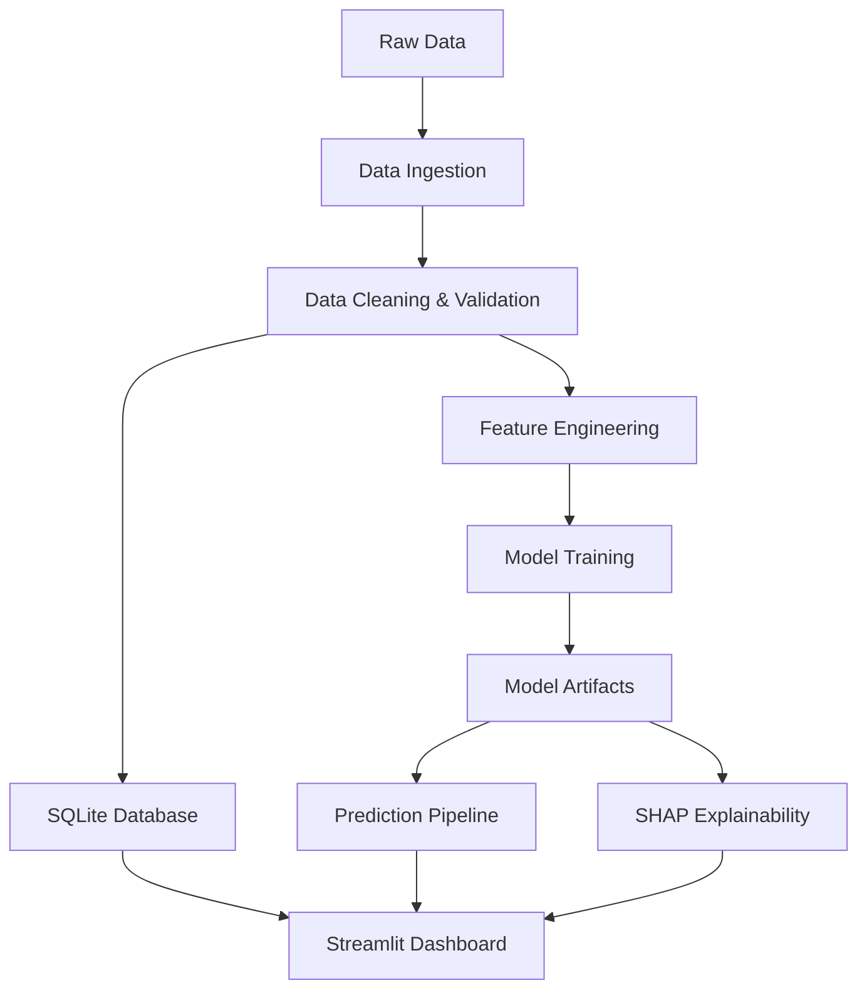

# Customer Intelligence AI

**Understand customers. Predict churn. Improve retention.**

A comprehensive, production-style data science application that combines enterprise-grade business intelligence, predictive machine learning, explainable AI, customer-level analytics, SQL insights, and interactive retention planning in one polished Streamlit application.

## Features

- **Executive Analytics Dashboard**: High-level KPIs, churn trends, and business insights
- **Customer Explorer**: Interactive search and filtering of customer data with predictions
- **Individual Churn Prediction**: Predict churn probability for customer profiles with SHAP explanations
- **Model Lab**: Train, evaluate, and compare multiple ML models (Logistic Regression, Random Forest, XGBoost)
- **Explainable AI**: Understand model predictions using SHAP (SHapley Additive exPlanations)
- **SQL Analytics**: Query customer data using SQL with predefined and custom queries
- **Retention Simulator**: Simulate hypothetical retention campaigns and financial outcomes

## Technology Stack

- **Language**: Python 3.8+
- **Data Processing**: Pandas, NumPy
- **Database**: SQLite
- **Machine Learning**: scikit-learn, XGBoost
- **Explainability**: SHAP
- **Visualization**: Plotly Express, Plotly Graph Objects
- **Application**: Streamlit
- **Testing**: pytest
- **Version Control**: Git

## Dataset

This application uses the **IBM Telco Customer Churn Dataset**:

- **Source**: [IBM Telco Customer Churn on ICP4D](https://github.com/IBM/telco-customer-churn-on-icp4d)
- **License**: Apache License 2.0
- **Attribution**: This dataset is provided by IBM for educational and analytical purposes
- **Size**: 7,043 customer records (7,010 after cleaning)
- **Features**: 21 columns including customer demographics, services, contract details, and churn status

## Architecture



## Project Structure

```
PredictCX/
├── app.py                          # Main application entry point
├── pages/                          # Streamlit multi-page application
│   ├── 01_Executive_Dashboard.py
│   ├── 02_Customer_Explorer.py
│   ├── 03_Churn_Prediction.py
│   ├── 04_Model_Lab.py
│   ├── 05_Explainable_AI.py
│   ├── 06_SQL_Analytics.py
│   └── 07_Retention_Simulator.py
├── src/
│   ├── data/                       # Data ingestion and validation
│   │   └── ingestion.py
│   ├── features/                   # Feature engineering
│   │   └── engineering.py
│   ├── models/                     # Model training and inference
│   │   ├── training.py
│   │   └── inference.py
│   ├── explainability/            # SHAP explanations
│   │   └── shap_explainer.py
│   ├── analytics/                  # Business metrics
│   │   └── metrics.py
│   ├── database/                   # SQLite operations
│   │   └── db_operations.py
│   └── visualization/             # Chart functions and themes
│       └── charts.py
├── data/
│   ├── raw/                        # Original dataset
│   └── processed/                  # Cleaned dataset and database
├── models/                         # Saved model artifacts
├── scripts/                        # Setup and training scripts
│   ├── setup_database.py
│   └── train_models.py
├── tests/                          # Automated tests
├── sql/                            # SQL queries (if needed)
├── notebooks/                      # Exploratory analysis notebooks
├── requirements.txt
├── .gitignore
└── README.md
```

## Installation

### Prerequisites

- Python 3.8 or higher
- pip (Python package manager)
- Git (for version control)

### Local Installation (macOS/Linux)

1. **Clone the repository**:
   ```bash
   git clone <repository-url>
   cd PredictCX
   ```

2. **Create a virtual environment** (recommended):
   ```bash
   python -m venv venv
   source venv/bin/activate  # On macOS/Linux
   # On Windows: venv\Scripts\activate
   ```

3. **Install dependencies**:
   ```bash
   pip install -r requirements.txt
   ```

4. **Run data ingestion**:
   ```bash
   python src/data/ingestion.py
   ```
   This will download the IBM Telco Customer Churn dataset, clean it, and save it to `data/processed/`.

5. **Initialize the database**:
   ```bash
   python scripts/setup_database.py
   ```

6. **Train the models**:
   ```bash
   python scripts/train_models.py
   ```

7. **Launch the application**:
   ```bash
   streamlit run app.py
   ```

   The application will open in your browser at `http://localhost:8501`

### Local Installation (Windows)

1. **Clone the repository**:
   ```cmd
   git clone <repository-url>
   cd PredictCX
   ```

2. **Create a virtual environment**:
   ```cmd
   python -m venv venv
   venv\Scripts\activate
   ```

3. **Install dependencies**:
   ```cmd
   pip install -r requirements.txt
   ```

4. **Run data ingestion**:
   ```cmd
   python src\data\ingestion.py
   ```

5. **Initialize the database**:
   ```cmd
   python scripts\setup_database.py
   ```

6. **Train the models**:
   ```cmd
   python scripts\train_models.py
   ```

7. **Launch the application**:
   ```cmd
   streamlit run app.py
   ```

## Model Performance

The application trains and evaluates three models:

| Model | CV ROC-AUC | Test ROC-AUC | Test F1 | Test Precision | Test Recall |
|-------|------------|--------------|---------|---------------|-------------|
| Dummy Classifier (Baseline) | 0.5015 ± 0.0058 | 0.5001 | 0.2658 | 0.2647 | 0.2668 |
| Logistic Regression | 0.8434 ± 0.0056 | 0.8464 | 0.6160 | 0.5106 | 0.7763 |
| Random Forest | 0.8195 ± 0.0070 | 0.8198 | 0.5480 | 0.6436 | 0.4771 |

**Best Model**: Logistic Regression (Test ROC-AUC: 0.8464)

## Testing

Run the automated test suite:

```bash
pytest tests/ -v
```

All tests should pass. The test suite covers:
- Data ingestion and validation
- Feature engineering
- Database operations
- Business metrics calculations
- Retention scenario calculations

## Deployment

### Streamlit Community Cloud

1. **Push your code to GitHub** (see GitHub section below)

2. **Create a Streamlit Community Cloud account**:
   - Go to [https://share.streamlit.io](https://share.streamlit.io)
   - Sign up with your GitHub account

3. **Deploy your app**:
   - Click "New app"
   - Select your repository
   - Select the main branch
   - Set the main file path to `app.py`
   - Click "Deploy"

4. **Configure environment variables** (if needed):
   - In the app settings, add any required environment variables
   - For this app, no additional environment variables are required

5. **The app will be deployed** and available at a URL like `https://yourusername-predictcx-app.streamlit.app`

### Deployment Considerations

- The dataset is downloaded during the first run, so ensure the app has internet access
- Model artifacts are saved in the `models/` directory and should be committed to Git
- The SQLite database is created during setup and is stored in `data/processed/`
- For production use, consider:
  - Using a production database (PostgreSQL, MySQL)
  - Implementing authentication and authorization
  - Adding monitoring and logging
  - Setting up automated retraining pipelines
  - Implementing A/B testing for model updates

## GitHub Integration

### Initial Setup

1. **Initialize Git repository** (if not already done):
   ```bash
   git init
   ```

2. **Add all files**:
   ```bash
   git add .
   ```

3. **Create initial commit**:
   ```bash
   git commit -m "Initial commit: Customer Intelligence AI application"
   ```

4. **Create a new repository on GitHub**:
   - Go to [https://github.com/new](https://github.com/new)
   - Repository name: `PredictCX` (or your preferred name)
   - Description: "Customer Intelligence AI - Churn Prediction & Retention Analytics Platform"
   - Choose Public or Private
   - Do NOT initialize with README (we already have one)
   - Click "Create repository"

5. **Add remote and push**:
   ```bash
   git remote add origin https://github.com/yourusername/PredictCX.git
   git branch -M main
   git push -u origin main
   ```

### Checking Git Status

```bash
git status
```

### Viewing Changes

```bash
git diff
```

### Committing Changes

```bash
git add .
git commit -m "Your commit message"
git push
```

## Configuration

### Streamlit Configuration

Create a `.streamlit/config.toml` file for custom settings:

```toml
[theme]
primaryColor = "#00D4FF"
backgroundColor = "#0A0E27"
secondaryBackgroundColor = "#121836"
textColor = "#E0E6ED"
font = "sans serif"
```

### Environment Variables

No environment variables are required for basic operation. Optional variables can be added for:
- Custom dataset URLs
- Database connection strings (if using external databases)
- API keys (if integrating external services)

## Troubleshooting

### Dataset Not Found

**Error**: `Dataset not found at data/raw/telco_customer_churn.csv`

**Solution**: Run the data ingestion script:
```bash
python src/data/ingestion.py
```

### Database Not Found

**Error**: `Database not found at data/processed/customer_churn.db`

**Solution**: Run the database setup script:
```bash
python scripts/setup_database.py
```

### Model Not Trained

**Error**: `Model not trained. Please train models first.`

**Solution**: Run the model training script:
```bash
python scripts/train_models.py
```

### SHAP Not Available

**Error**: `SHAP is not installed`

**Solution**: Install SHAP:
```bash
pip install shap
```

### Port Already in Use

**Error**: `Port 8501 is already in use`

**Solution**: Use a different port:
```bash
streamlit run app.py --server.port 8502
```

## Limitations and Responsible Use

### Dataset Limitations

- The IBM Telco Customer Churn dataset is for educational and analytical purposes
- Historical patterns may not generalize to all customer segments or time periods
- The dataset does not include all factors that influence churn in real-world scenarios

### Model Limitations

- Model predictions may be incorrect and should support, not replace, business judgment
- The model may not generalize to new customer segments or changing market conditions
- Class imbalance in the dataset (26.5% churn rate) affects model performance
- Model calibration should be validated before using predictions for critical decisions

### Responsible Use Guidelines

- Do not use sensitive or irrelevant information to justify customer treatment
- Explain that model predictions may be wrong and should support business judgment
- Document risks of class imbalance, calibration errors, data drift, and changing customer behavior
- Avoid claiming the model is production-ready for real customer decisions without additional validation, monitoring, and governance
- Use predictions as one input in retention decision-making, not as the sole criterion

## Screenshots

*Note: Screenshots will be added after the application is deployed and tested.*

## Live Demo

*Placeholder: Live demo URL will be added after deployment.*

## Contributing

Contributions are welcome! Please follow these guidelines:

1. Fork the repository
2. Create a feature branch (`git checkout -b feature/amazing-feature`)
3. Commit your changes (`git commit -m 'Add amazing feature'`)
4. Push to the branch (`git push origin feature/amazing-feature`)
5. Open a Pull Request

## License

This project is licensed under the MIT License.

## Acknowledgments

- **IBM** for providing the Telco Customer Churn Dataset
- **Streamlit** for the excellent Python framework
- **scikit-learn** for the machine learning library
- **SHAP** for the explainable AI library
- **Plotly** for the interactive visualization library

## Contact

For questions, issues, or suggestions, please open an issue on GitHub.

---

**Built with ❤️ using Python, Streamlit, and Machine Learning**
